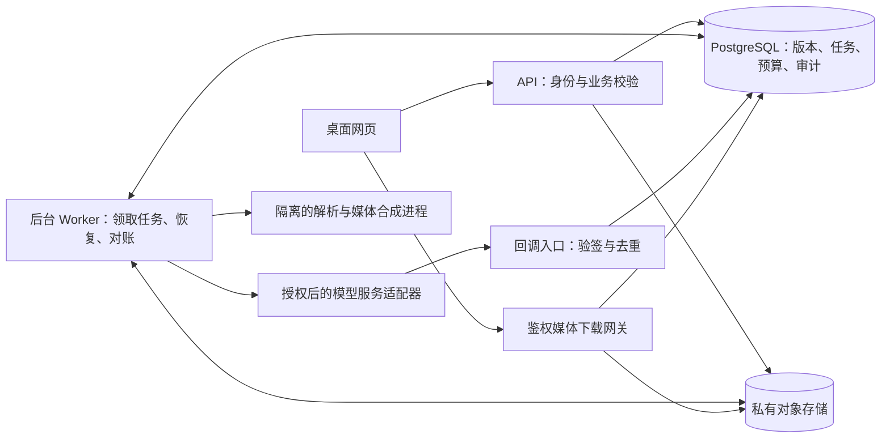

# AIGC 营销工作台技术设计 v0.4

> 日期：2026-11-10｜阶段：PoC 技术评审草稿｜负责人：HX
> 依据：[PRD v0.4](01_产品需求文档_PRD_v0.4.md)。当前目录有文档与交互原型，本文为后端及真实模型接入的拟实施设计，不代表已有代码、接口、部署或验收证据。

## 1. 设计结论与范围

采用模块化单体 API、独立后台 Worker、PostgreSQL 和私有对象存储。用确定性任务状态机组织固定生产流程，模型只产出候选；账户隔离、事实引用、版本、预算、任务提交和发布检查均由服务端控制。

P0 跑通一个 SKU 的三图、所选平台各一条视频、一张营销海报／视频封面／标题文案及 manifest。支持局部修改、恢复、取消、历史版本与部分导出。不实现批量矩阵、团队协作、自动发布、投流、充值支付、RAG、自训或开放式 Agent。

**首版技术路线（2026-11-10 用户确认）：** 采用“API＋原图合成＋人工复核”。ComfyUI 不进入首版关键依赖，不建设其部署、节点管理或生产适配器，仅保留为后续对照实验候选；不以其选型结果阻断首版实现。商品保真、局部修复和拒用机制仍为 P0，具体服务及方案效果须通过真实 SKU 验证。本文其余技术栈是建议，版本与部署配置在工程初始化和 PoC 后冻结。

## 2. 架构与技术选择

| 层 | 建议方案 | 取舍与边界 |
|---|---|---|
| 网页 | TypeScript＋React，工作台／商品档案／一键出片／作品／任务中心 | 按 PRD v0.4 三步主流程，编辑按需展开；组件库和视觉方案另经原型确认 |
| API | Python＋FastAPI，类型化请求与响应 | 只处理短请求、确认与查询；渲染和生成不在请求进程执行 |
| 数据 | PostgreSQL，迁移脚本版本管理 | 事务、唯一约束及行锁保护预算与状态；生产任务不依赖内存队列 |
| 调度 | 数据库任务表＋独立 Worker | PoC 低并发减少中间件；队列表与业务记录同事务提交；后续容量有证据再考虑消息队列 |
| 媒体 | 私有对象存储＋隔离合成进程，FFmpeg 候选 | 原始与派生文件分区；产物须实际探测且完整保存后才成功；构建、编解码与许可待冻结 |
| AI | 每类能力一个候选 API Provider | 薄适配器隔离提交、查询、取消和账单差异；首版不部署 ComfyUI 或自托管生成模型，不预建多模型路由 |
| 部署 | API／Worker 分进程或容器，数据库与对象存储独立持久化 | 开发可单机；试用环境拓扑、地域及备份方案待测后定 |

PostgreSQL 官方文档提供行级锁与显式锁语义，本设计据此串行化同一预算账户的竞争更新；仍需并发与死锁测试。[官方锁文档](https://www.postgresql.org/docs/current/explicit-locking.html)

FastAPI 文档将重型计算列为需要考虑独立任务工具的情形；本设计将长任务移出 API，持久化调度方案是本项目设计，并非框架自动提供的保证。[官方后台任务说明](https://fastapi.tiangolo.com/tutorial/background-tasks/)

## 3. 模块与职责

| 模块 | 责任 | 对应需求 |
|---|---|---|
| Identity | 登录、服务端会话、工作空间隔离、排障授权 | FR-16 |
| Catalog / Ingestion | SKU、上传、逐文件解析、来源定位、事实确认 | FR-01、FR-02、FR-03 |
| Planning | 卖点、双平台脚本分镜、计划版本与费用估计 | FR-04、FR-05 |
| Assets / Review | 图片、关键帧、保真提示、修复、人工采用 | FR-06、FR-07、FR-08 |
| Production | 动态镜头、音轨、字幕、确定性合成 | FR-09、FR-10 |
| Export | 检查、样片／发布包、manifest、版本依赖 | FR-11、FR-12、FR-15 |
| Execution / Budget | 幂等、持久化任务、费用预留、取消恢复 | FR-13、FR-14 |

模块共享数据库但不得绕过领域校验直接更改其他模块的状态。Provider 适配器只能返回外部事实，不能直接批准预算、采用资产或完成套件。

## 4. 数据模型与约束

所有业务对象含数据库生成 ID、workspace_id、created_at；时间存 UTC、页面按用户时区显示。引用采用包含 workspace_id 的复合外键，阻止跨账户关系；服务端同时检查 SKU 一致性。金额用固定精度十进制与币种，禁止二进制浮点；内部精度及供应商计价舍入规则须在适配时冻结。

| 对象／建议表 | 主要字段 | 必须约束 |
|---|---|---|
| workspace / account | owner、session、status | 首版一个私有空间；管理员无默认内容读取权 |
| sku / project | merchant_sku、spec、lifecycle | 空间内商家 SKU 标识唯一；删除中不可启动任务 |
| source_file | object_key、hash、type、size、parse_status、rights_record | 同名不覆盖；提交上传完成后复核实际文件；空间内去重不能覆盖版本 |
| source_locator | file_id、page／paragraph／region | PDF 页码、DOCX／TXT 段落、图片区域；手填来源另记确认人 |
| profile_version / fact | version、value、unit、locator、confirmed_by、validity | 确认内容不可变；有效性单独记录 active／superseded／revoked |
| plan_version / shot | profile_version、platform、ordinal、duration、narration、fact_refs、asset_refs | 计划校验冻结后内容不可变，不要求人工逐镜确认；镜头序号在同计划平台内唯一 |
| creation_request / work | profile_snapshot、platforms、duration、defaults_version、consent、current_result | 请求快照不可变；工作空间/商品一致；作品独立保留 |
| copy_version / edit_draft / result_revision | origin、base_revision、字段补丁、渲染引用、expected_revision | 候选不覆盖人工稿；草稿与已合成结果分离；乐观并发校验 |
| asset_version / dependency | kind、sku_id、parents、content_hash、generation_config | 文件不可原位覆盖；依赖无环且同 SKU；原始、生成、合成区分 |
| review_record | target_version、check_type、decision、reviewer、reason | 审核绑定精确版本；新版本不能继承失效的审核 |
| suite / suite_item | plan_version、slot、selected_version、status | 固定交付槽位，唯一选择；系统暂选与人工采用分别记录 |
| processing_consent | provider、purpose、data_scope、valid_until、revoked_at | 外发对象必须属于授权范围；服务商变化重新授权 |
| budget_authorization | scope、plan_or_input_version、price_version、currency、cap、expiry | 解析前尚无计划，绑定不可变输入清单；生成前绑定creation_request快照，派生计划记录授权血缘，不能扩大范围 |
| task / task_step | phase、state、attempt、lease、fencing_token、cancel_requested | 领取与状态变更事务化；旧租约不能覆盖新持有者结果 |
| external_call | intent_key、request_hash、provider、external_id、submission_state | intent_key 唯一；外部 ID 按供应商账户作用域唯一 |
| reservation / ledger_entry | call_id、reserved_remaining、settled_amount、event_key、evidence | 费用事件去重；未知费用保持预留；修正写调整记录而非抹历史 |
| export_package | mode、selection_hash、manifest_hash、rule_version、state | 发布包输出选择不可变；下载时重新校验撤销与删除状态 |
| audit_event / deletion_job | actor、action、target、request_id、state | 日志不存密钥与业务全文；删除任务可重试且结果可核查 |

常用索引：任务(state, next_run_at)、对象(workspace_id, created_at)、依赖(parent_version)、外部调用(provider, external_id)、审计(workspace_id, target_id)。分页查询，不把媒体二进制写入数据库。具体 DDL、迁移和回滚脚本尚待实现。

## 5. 生产流程与人工节点

1. 用户上传前选择 SKU 并确认素材权利；API 校验配额并发放受限上传位置。完成后检查真实格式、大小、hash 与媒体时长，逐文件入库。
2. 本地解析在隔离进程执行；扫描页走 OCR 候选。需外部服务或费用时先取得输入清单授权与预算。读取失败不阻止其他文件，不能以空内容伪装成功。
3. 提取事实候选及来源，冲突并列；用户确认生成档案快照。缺必需项允许草稿，禁止生产。
4. 以已确认档案创建不可变创作请求，记录所选平台、自定义时长、默认策略版本和可选创意要求。统一授权覆盖文本、图像、视频、配音与合成的有界样片流程。AI默认生成标题、发布正文、口播、分镜和事实引用；校验后冻结派生计划并自动继续，不要求用户先写文案或确认每镜。
5. 按计划产生三图与关键帧：白底图使用原主体抠图合成；场景图优先由 API 生成背景，再合成真实商品主体并处理边缘、遮挡与阴影。局部问题采用原图回贴、遮罩编辑或图像编辑 API；每次修复产生新候选。自动检查只提供提示，系统可暂选通过基础检查的候选用于未审核内部样片；发布前用户集中对照原图复核并采用，不能因保留主体就免除保真审核。
6. 内部样片可使用系统暂选画面生成所需动态镜头；已知关键失真或规则拒绝的画面阻断；发布只允许人工已采用版本。对合格画面生成动态镜头；配音、字幕、配乐分别形成资产版本。动态失败等待用户选择静图方案，不自动切换。
7. 合成进程消费不可变渲染清单，输出临时对象，经媒体探测与保存校验后发布为新资产。音画时长不匹配阻断，不能任意加速配音掩盖问题。
8. 用户完成事实、保真、表达及授权复核；服务端检查平台规则版本、规格和标识，生成发布包。未核验规则只允许内部样片。

输入上限继承 PRD 拟定值：20 图、10 文档、5 视频；单图 20 MB、单文档 30 MB／PDF 100 页、单视频 200 MB／120 秒、项目 1 GB。配额包含在途上传预留，失败或过期上传回收预留；上限须测试后定稿。压缩展开、像素数、解析内存及 CPU 时间另设服务端资源限制，不接受仅扩展名校验。

### 5.1 一键编排与文案契约（FR-18～20）

新增 creation_request：workspace、profile_version、source_snapshot、selected_platforms、duration_seconds、optional_brief、defaults_version、provider/price_versions、budget_authorization、consent、revision、idempotency_key。未生成计划时授权绑定请求快照；派生计划只能在已授权平台、输入、用途、服务商和预算范围内继续。平台/资料/服务商/费用上界变化需重新授权，刷新或恢复不产生新授权。

固定流水线：预检 → AI文案 → 结构与事实校验 → 自动分镜与暂选画面 → 动态/配音/字幕/配乐 → 视频合成与媒体探测；并行海报文案/排版/渲染/图像探测 → 分支汇总 awaiting_review。所有步骤持久化；任务技术完成与人工采用仍独立。复用预算行锁、外发幂等和未知状态核查，不由模型决定执行状态。

copy_version 必含 selected_platform、title、body、narration、shots、fact_refs、origin(ai/human)、parent_version、request_revision、model/prompt/schema版本；AI生成记录不能以占位或预置模板伪造。每个所选平台生成一套，未选平台不发起调用。参数/认证/价格逐项校验来源；平台风格只为表达建议，不制造个人实测体验。

POST /creation-requests 预检并返回费用与数据范围；POST /creation-requests/{id}/runs 接受明确授权，202返回同一幂等任务；GET查询按阶段展示，无真实分母不造百分比。POST /copy-versions/{id}/rewrite 返回指定平台/段落的新候选，携带expected_revision；系统暂选与人工采用分别记录，人工稿版本冲突返回409。POST /copy-versions/{id}/adopt 仅保存选定版本并计算依赖失效，不隐含付费执行。

时长由服务端检查正整数、服务能力与估算上界；镜头时长合计必须等于请求时长，不能任意加速口播。内容过长则返回可调整候选／明确提示；平台能力或预算不支持时暂停，不偷偷改成15秒。

标题/发布正文修改只更新文案与导出清单；口播修改更新受影响配音/字幕/时间轴/合成；画面不无故重生。生成结果写入原请求版本，迟到结果不得覆盖当前人工稿。人工集中审核按明确资产版本逐条落库，不用一个无对象的“通过”布尔值替代。

性能验收：合并入口不得增加相同输入的外部调用；标题改动媒体调用数0、字幕样式改动生图/生视频/配音调用数0。记录文本、媒体、渲染分阶段耗时、调用数、缓存复用和峰值资源；真实基线与P95阈值待选型实测，不以原型计时宣称推理性能。预检短请求不得同步等待模型，沿用后台Worker。

### 5.2 结果编辑与版本合同（FR-21）

result_revision 固定引用 rendered_media_version、poster_asset_version、poster_copy_version、copy_version、shot/asset/voice/music/subtitle_versions。编辑创建 edit_draft，包含base_revision、draft_revision、affected_platforms、字段变更与意图；播放器只读已合成media_version，不能直接使用草稿字幕伪造新样片。作品保存不隐含重渲染。

PATCH /works/{id}/draft 带expected_revision，成功保存新文案版本并返回影响；冲突409，不覆盖当前人工稿。POST /works/{id}/change-quotes 根据字段级依赖图返回invalidated_nodes、reused_nodes、费用上界和需要的授权。POST /works/{id}/apply 在授权有效及幂等键固定后启动最小子图；完成后原子创建result_revision并切换current_result，失败仍播放旧版。恢复历史同样建立新草稿，禁止覆盖历史或复活已撤销事实。

| 变更 | 重算节点 | 不应调用 |
|---|---|---|
| 标题/发布正文 | copy_version、规则检查、导出manifest | 所有媒体服务 |
| 镜头口播 | 该镜配音、字幕时间轴、合成、媒体探测 | 无关画面生成 |
| 镜头画面 | 对应画面引用/必要生成、合成、探测 | 无关配音与其他镜头生成 |
| 配音声音 | 配音、字幕时间轴、合成 | 生图 |
| 海报文案/排版 | 对应海报渲染与图像探测 | 视频、动态与配音服务 |
| 配乐/字幕样式 | 音轨混合或样式、合成、探测 | 生图、生视频、口播配音 |

共享画面影响多个平台时，报价列出所有受影响平台；发布检查不得把一个平台审核套到另一个平台。文案AI重写与初次生成同样受外发和预算授权约束；若超出现有授权，候选生成前取得新授权。重写响应携带base_draft_revision，只入候选区，采用是独立写操作。

### 5.3 配套海报分支（FR-23）

复用同一creation_request中的商品事实/所选平台，按平台派生poster_spec（width、height、safe_area、template_version、product_asset_ref、title、selling_points、fact_refs、font_version）。文案生成包含海报独立文案字段，不以视频字幕或封面截图代替营销海报；每个所选平台首版1张。

海报使用确定性图文合成（固定受控模板＋字体与排版规则），AI只产出可校验文案/背景候选；渲染器测量文字换行与边界、商品遮挡、尺寸/格式，不能静默截断卖点。超长文案返回可编辑候选或安全缩排范围；超限进入待处理。海报产物输出PNG/JPEG，不把SVG原型示意当生产交付。

海报和视频是共享输入、独立输出分支。poster_render失败只恢复该分支；视频已完成仍可预览与审核。仅修改poster_copy/layout只执行poster_render、探测、审核失效；视频、动态、TTS调用数0。更新共享商品资产时按dependency反向遍历列出受影响视频和海报，用户确认范围后执行。

suite_item.slot新增poster/{platform}，manifest记录kind=marketing_poster、平台、尺寸、poster_spec/asset/copy版本、事实与审核。GET /works/{id}返回video_results和poster_results及分支状态。导出POST /export-packages.selection可选video_only、poster_only、full_suite，并在服务端展开为精确资产版本；full_suite缺任一所选平台海报不得标完整。海报可独立审核，但所有权、事实撤销和平台规则门禁相同。

### 5.4 作品、任务与页面状态（FR-22）

work 保存所属SKU与创作请求ID；同一商品可多作品，每个作品有独立请求/历史。GET /works 与 GET /tasks 仅展示同workspace的真实记录，支持分页；任务返回work_id、阶段、动作能力和费用状态。导航、刷新、列表打开均只读取已有对象，不能触发POST运行。

前端URL携带work_id，编辑草稿本地缓存仅作恢复辅助，服务端版本为准。参数默认值与本次请求参数分开保存；变更默认平台不能改写历史请求。源档案更新须显式迁移到新请求；旧作品依然绑定原快照，但撤销事实触发发布门禁。

预检错误返回field、code、message、suggested_action；pending_fact回档案、failed允许确定范围的恢复/人工编辑、unknown只允许查询/取消后续步骤、awaiting_review进入结果页。暂停仅停未提交步骤，恢复同task_id；取消与费用结算独立。前端依据服务端allowed_actions展示按钮，不自行推断收费安全。

集中复核提交selection_hash、result_revision及每平台/资产的decision集合。事务内重查版本、事实有效性、已知缺陷、规则版本、素材权利与规格；任一变化返回409/明确阻断，不能以客户端勾选代替校验。成功只记录明确展示并确认的对象，不自动发布。

## 6. 状态、持久化与恢复

### 6.1 三类状态独立

| 对象 | 状态及规则 |
|---|---|
| 计划 | draft → validated_preview → pending_release_review → confirmed；样片可使用validated_preview，发布必须confirmed；编辑创建新版本 |
| 执行任务 | queued → running → succeeded／failed；running 可转 external_unknown，核查后恢复或终结 |
| 取消 | queued／running／external_unknown 接受取消请求；停止新步骤，canceling → canceled；费用核查独立继续 |
| 审核 | pending／approved／rejected／stale；只批准精确资产版本 |
| 套件 | 全部必需项通过且 manifest 一致为 complete；否则有通过项为 partial；无通过项但有待审项为 pending_review；其余 producing；同时返回待审和缺失数量 |

最后一行是对 PRD 重叠状态的拟定展示优先级，不改变部分完成的业务语义。任务成功只表示技术产物存在；任务失败或取消原因作为独立字段显示，不能由套件状态掩盖。

### 6.2 领取与崩溃恢复

API 在同一数据库事务创建任务、步骤及预算预留。Worker 用短事务领取到期任务并更新租约与递增 fencing_token，执行时不持有长数据库锁。心跳续租，所有结果写入校验 token。

步骤区分纯本地可重做、已确认未外发、正在外发、外部处理中与未知。租约到期仅代表执行者失联，不代表供应商未接收请求：纯计算可重新领取；外发开始后的步骤先核查，禁止直接重发。外部调用意图在网络发送前持久化，发送后崩溃的窗口无法靠本地事务消除。

所有消费按“至少一次唤醒＋幂等处理”设计，不宣称端到端恰好一次。使用同一调用键查询／重放必须以供应商已验证的幂等契约为前提；不支持时未知进入人工核查。回调验签、校验供应商账户和任务绑定，持久化去重后快速返回；轮询与回调走同一事件归并入口。

取消提交与 Worker 外发需串行争用同一任务的提交许可：取消先取得许可则不发送；Worker 已记录发送开始则视为已提交边界，即使随后才抵达供应商，也提示可能计费并尝试取消。迟到结果更新外部事实与账目，不复活终态或自动选入套件。

### 6.3 错误与重试

| 类别 | 行为 |
|---|---|
| 鉴权／参数／业务审核拒绝 | 不自动重试，返回可操作原因 |
| 429／暂时故障且证实未提交 | 最多重试 2 次；指数退避并遵从服务端等待提示，受总截止时间和预算约束 |
| 响应丢失、提交状态不明 | external_unknown，保留证据，查询／对账；不自动新建 |
| 模型结构错误 | 预算内最多修复一次；仍失败仅保存可编辑错误草稿，不进入下游 |
| 合成／存储失败 | 保留有效输入；恢复只重做失败步骤，临时对象清理不删除已采用资产 |
| 查询截止时间到达 | 停止自动轮询并显示待核查；不释放未知预留，不等同外部失败 |

## 7. 预算、授权与并发

外发同意与成本授权分别记录。解析／文本起草等前置调用没有已确认创作计划时，以不可变上传清单或请求快照作为授权范围，避免为完成档案而先要求档案确认。后续生成绑定不可变创作请求和其派生计划版本；任何费用授权都不代表平台收取用户付款。

预算占用必须包含**全部未结清预留**，既包括正常执行中的任务，也包括未知状态。PRD 6.1 的未知预留条件在此具体化为更完整的并发约束：

`可用金额 = 授权上限 − 已结算费用 − 所有调用的未结清预留`

在预算行锁保护的同一事务内检查作用域、币种、价格版本、期限、任务取消状态和可用金额，再创建唯一调用意图与新预留。已有幂等键先比较 request_hash：相同返回旧结果，不同拒绝。事务提交后才允许 Worker 外发。

费用结算将本调用对应预留转为已确认费用，不能把同一部分同时计入两者；分次账单使用事件唯一键及剩余预留。实际费用尚不最终时保留剩余上界；最终未收费／结清证据到达后释放余额。供应商实际收费意外超过承诺上界时如实记账、告警并停用后续调用，不截断账目制造合规；该供应商必须复评。

收费轮询、修复及重试均纳入上界。授权过期／撤销立即停止新收费动作；已有未知调用保留记录并人工核查。并发锁顺序固定为预算、任务、调用；死锁回滚可重试本地事务，绝不能因此重复网络发送。

## 8. 版本依赖与局部修改

依赖图保存事实→脚本／镜头→图像／动态／音轨→合成→封面／发布包的实际引用。复用键由工作空间、SKU、输入版本、生成配置、模型／Prompt／规则版本组成；不跨账户复用商家资产。

| 修改 | 失效与执行范围 |
|---|---|
| 字幕样式 | 重合成与视觉复核；图像、视频生成及配音调用数为 0 |
| 字幕错字 | 先核对口播与事实；仅文字错误则重合成，口播错误则更新配音及时间轴 |
| 口播文字 | 受影响配音、字幕和时间轴更新；画面素材可复用 |
| 单镜画面 | 该镜头、受影响合成及封面更新；其他镜头保留 |
| 参数／价格 | 标记引用该事实的文案与画面待更新，不全量重生无关素材 |
| 档案撤销 | 依赖该事实的发布导出和下载阻断；已外部下载的包无法撤回，提示停止使用 |
| 历史回退 | 新建回退版本并重新校验当前事实与授权；不覆盖旧版、不复活撤销事实 |

更新影响计算只提出待确认计划，不自动支付。生成前和导出前均重新校验依赖，避免用户编辑期间旧任务结果成为当前版本。

## 9. API 与契约草案

以下为待实现接口，不是已部署 API。统一前缀 `/api/v1`，JSON 请求；所有写操作要求会话身份，成本或任务动作另要求 Idempotency-Key。服务端从会话推导工作空间，不信任客户端 workspace_id。修改草稿传 expected_revision，冲突返回 409。

| 方法与路径 | 语义与结果 |
|---|---|
| POST /sessions；DELETE /sessions/current | 登录／退出；身份接入方式在初始化前确定，限速、失效和恢复流程必须测试 |
| POST /skus；GET /skus | 创建与分页列表 |
| POST /projects/{id}/uploads；POST /uploads/{id}/complete | 预留上传配额、登记实际文件；类型或大小错误逐项返回 |
| POST /sources/{id}/parse | 本地解析或携带外发／费用授权启动解析任务，返回 202 task_id |
| POST /skus/{id}/profiles；POST /profiles/{id}/confirm | 保存草稿与冻结版本；缺字段／冲突返回 422 |
| POST /plans/draft-tasks；POST /plans/{id}/confirm | 起草候选与确认；模型起草同样受预算及外发授权限制 |
| POST /processing-consents；POST /budget-authorizations | 明确同意对象、范围及金额；返回不可变授权快照 |
| POST /plans/{id}/runs | 校验计划、授权及幂等后返回 202；重复返回相同 run_id |
| GET /tasks/{id}；POST /tasks/{id}/cancel | 查询真实阶段／费用／可操作项；取消返回接受状态而非保证外部取消 |
| POST /assets/{id}/reviews；POST /suites/{id}/selections | 人工审核与选择，分别记录，选择不替代审核 |
| POST /plans/{id}/change-previews；POST /plans/{id}/versions | 计算影响与费用范围，再建立新版本；不自动执行 |
| POST /exports；GET /exports/{id}/download | 明确 mode=sample／release 与文件版本；异步打包，下载再校验 |
| DELETE /projects/{id}；GET /deletions/{id} | 撤销访问并异步清除，返回 202；不假报已物理删除 |
| POST /providers/{provider}/events | 仅供应商验签入口，无用户会话；重复事件去重 |

统一错误对象：code、message、request_id、retryable、details（脱敏）。建议业务码包括 VERSION_CONFLICT、FACT_REVOKED、CONSENT_REQUIRED、BUDGET_INSUFFICIENT、EXTERNAL_STATE_UNKNOWN、REVIEW_REQUIRED、RULESET_UNVERIFIED、PROJECT_DELETING。越权对象返回统一不存在响应；403 用于已知资源但当前动作不允许。幂等键与旧结果至少覆盖任务及对账保留周期，期限待保留策略冻结，不能在任务未结清时过期。

任务查询返回 execution_state、phase、review_state、suite_state、missing_items、estimated_cost、reserved_cost、settled_cost、unknown_cost_flag、next_actions。没有真实进度分母时不返回虚构 percent。前端轮询可退避并暂停不可见页面，刷新后以 task_id 恢复；实时推送不作为 P0 必需。

## 10. AI 与媒体契约

文本候选必须包含 schema_version、profile_version_id、platform、shots。每镜含时长、口播、画面说明、生成方式和 fact_refs；模型只可引用服务端提供的引用标识，正式镜头 ID 由数据库生成。拒绝未知字段、跨档案引用、负时长及非支持平台；总时长、数值和单位由服务端验证。无法用规则证明的主观宣称进入人工审核，不能宣称 Schema 能证明内容真实。

适配器最小能力：estimate_upper_bound、submit、query、cancel（可不支持但须声明）、normalize_event、reconcile_cost。能力表记录幂等作用域、查询键、费用结算、取消语义、输入尺寸、数据地域和保留条款；未验证的能力不得填为支持。

资料作为不可信数据块，不执行其中指令或外链。Prompt 固定绑定档案与约束，生成简要创意依据和真实引用。运行记录保存模型、Prompt、Schema 与参数版本；敏感原文不进入通用日志。

媒体渲染清单包含精确素材版本、时间段、裁切、字幕、音量、字体音乐授权、输出预设和标识配置。只允许受控参数，不拼接用户提供的 shell 命令。PoC 输出继承 PRD：视频默认15秒、自定义正整数秒（15／30秒仅为测试样本）、9:16、1080×1920、H.264＋AAC；商品图 1:1、视频封面 3:4、营销海报3:4（1080×1440），均为测试预设。不得通过拉伸商品主体适配比例。

本文件给出字段语义；可执行 OpenAPI、JSON Schema、Prompt 正文、渲染 Schema 和供应商映射仍需作为代码契约实现与测试，当前未创建。

### 10.1 首版保真与修复实现边界

| 能力 | 首版路径 | 失败与验收 |
|---|---|---|
| 白底图 | 抠图工具／API 提取主体，确定性白底合成 | 检查轮廓、细小部件与 Logo；抠图失败可修正遮罩或换原图 |
| 场景图 | API 生成背景＋真实主体合成 | 检查比例、透视、边缘、光照与阴影；融合不合格换背景或修复，不默认重画整个商品 |
| 局部修复 | 原图回贴、遮罩编辑；需要生成式编辑时调用已选 API | 遮罩和参考图保存版本；检查编辑区域及非编辑区域是否意外改变，严重失真阻止采用 |
| 动态镜头 | 对已采用画面调用视频 API | 检查动态过程中的结构与 Logo；失败由用户选择静图方案，不自动引入 ComfyUI |

原图回贴仅在视角与几何关系适用时使用，不能用不匹配的贴片掩盖结构错误。允许人工复核与修正，不建设完整专业修图时间线。所有外部抠图、编辑及检测调用仍遵守授权与预算规则；自定义遮罩、位置及输入版本纳入复用键。

### 10.2 ComfyUI 后续评估条件

首版先验证上述基线路线。仅当反复出现基线无法解决的保真问题、稳定多步流程需要自动化，或总成本存在可验证优化机会时，再安排 ComfyUI 对照实验；本次不授权任何外发或付费实验。

实验使用同一组授权 SKU、输入、质量标准及预算口径，对比首轮保真、修复后采用率、人工时间、端到端耗时及成功素材总成本。成本包含算力、空闲、维护、失败和人工修复；目标与留出样本在实验前冻结。没有足够收益证据则维持首版路线。

只有质量达到 P0 门槛，并在成本或人工负担上达到预先约定的改进目标，且部署、许可、版本锁定与恢复能力验证通过后，才单独评审接入。即使未来接入，也只作为生成／修复执行组件，预算、权限、版本和业务任务状态继续由现有后台控制。

## 11. 导出、安全与删除

发布包固定槽位：white_background、scene_1、scene_2、douyin_video、xiaohongshu_video、两平台各 cover 和 copy、manifest。部分导出由用户明确选择，manifest 列明缺失项，套件不因此变 complete。

打包使用不可变选择快照：预检→构建→hash／媒体检查→事务复核依赖与审核有效性→可下载。打包期间事实撤销或项目删除则拒绝发布，临时包清理。每次下载重查权限和撤销；已有发布包不能以缓存绕过。

内部样片使用独立对象和清晰“内部样片／未审核”提示，不能仅在网页提示而让下载文件冒充审核通过。发布包按经核验的平台规则执行标识，样片提示不等同合规标识。manifest 包含 SKU、计划／档案与文件版本、平台、hash、审核、规则和授权来源摘要，不含原始业务附件或内部下载凭据。

会话使用安全 Cookie、CSRF 防护和登录限流；身份服务与恢复方式待选型。所有对象查询和下载须按空间授权，ID 难猜不能替代鉴权。浏览器下载经鉴权网关流式输出，避免直接长期签名 URL 无法即时撤销；删除后拒绝新请求，已传出字节无法回收。供应商读取优先受限网关令牌；其已取得副本的删除能力由条款与接口验证，不能承诺即时收回。

文件解析禁宏、禁外网、限制资源；Worker 的 Provider 出站域名白名单与密钥最小权限。管理员排障使用有时限、有范围的授权并留痕。导出、日志和错误均不得暴露密钥、原文或其他账户信息。

删除：事务标记 deleting、禁止新任务／新访问→撤销令牌并取消未提交任务→清理派生与原始对象、缓存和临时文件→核查外部清除与账目→记录物理清除结果。最小审计与费用保留按告知策略处理。备份恢复须重放删除清单，防止数据复活；保留期限和删除 SLA 在 G-04 前冻结，未验证不承诺具体天数。

## 12. 部署、性能、监控与回退

开发／自动化测试默认使用 Fake Provider，真实外发默认关闭。密钥不进入仓库。真实调用启用要求服务商、数据同意、价格版本、金额上限、执行与查询截止时间均有效；发布包开关另外要求平台规则已核验。

PoC 建议全局真实生成并发 1，渲染单独限流；必须同时约束供应商在途任务，不能仅限制本地 Worker 数。API 和渲染资源隔离，上传分块／流式传输，列表分页、缩略图预览。CPU／GPU、内存、存储吞吐和数据库连接上限需按测试环境确定。

| 测量项 | 方法与目标 | 当前证据 |
|---|---|---|
| 保存／状态读取 | 记录环境、数据规模、并发与 p50/p95；沿用 PRD 拟定 p95 ≤2 秒 | 未测 |
| 端到端生成 | 各阶段、排队、外部等待分别计时，冻结总截止时间后验收 | 未测，不承诺秒数 |
| 局部修改开销 | 字幕样式修改图／视频／配音调用数均为 0；核对渲染次数和时间 | 未测 |
| 数据库与资源 | 锁等待、查询次数、连接数、内存峰值、CPU/GPU、临时空间 | 基线与阈值待 PoC |
| 成本 | 所有失败／重试／渲染／存储费用除以完整采用套件数 | 未测，零成功不能除以零 |

记录 request_id、task_id、call_id、asset_version_id 贯通链路。监控 PRD MON-01 的失败、未知、重复回调、预算异常、队列延迟、渲染资源、导出失败及越权拒绝。越权成功或超授权提交立即停用相关入口；阈值和接收人未配置不得试用。未知状态必须在任务中心持续可见。

数据库备份与对象备份须配套执行恢复演练；RPO/RTO 由部署方案确认。应用回退前检查迁移兼容，使用扩展再收缩的迁移策略，不自动删列；配置回退保留历史版本。Provider 停用只阻止新请求，已有任务继续必要核查；模型回退不能绕过事实、预算或审核。故障恢复先重建状态与对账，再逐步恢复提交。

## 13. 测试、追踪与交付顺序

| PRD 用例 | 工程验证重点 | 证据 |
|---|---|---|
| E-01／FR-01 | 真格式、扫描页、加密损坏、超限、上传配额竞争、单项重传 | 文件样本与逐项结果 |
| E-02／FR-02 | 参数冲突、缺字段、不可变确认、来源定位 | 数据库断言与人审记录 |
| E-03／FR-03 | 跨规格资产、跨空间关联拒绝 | 关系约束与 API 测试 |
| E-04／FR-04 | 无价格认证、提示注入、无效引用、双平台差异 | 候选校验与运营评审 |
| E-05／FR-05 | 缺素材、费用未知、分镜时长错误 | 提交阻断和替代方案流程 |
| E-06／FR-06 | 三图独立版本、单项失败重做、下载模式 | 资产及调用记录 |
| E-07／FR-07 | Logo／材质失真、抠图边缘、背景融合、遮罩内外变化、局部修复与人审拒用 | 授权真实图对照、版本和标签；不依赖 ComfyUI |
| E-08／FR-08 | 复用同版本、改字幕零生成调用 | Fake 与真实调用账核对 |
| E-09／FR-09 | 动态失败、人工选择静图、禁止静默降级 | 端到端状态及人工记录 |
| E-10／FR-10 | 配音超时、字幕遮挡、授权缺失、变更失效 | 媒体探测与视觉检查 |
| E-11／FR-11 | 完整／部分包、manifest、样片隔离、撤销竞态 | 包内容 hash 与权限测试 |
| E-12／FR-12 | 单镜修改、事实撤销、历史回退 | 依赖图与版本断言 |
| E-13／FR-13 | 双击、并发预算仅够一次、事件去重、前置授权 | 真实数据库并发测试及账目 |
| E-14／FR-14 | 外发前后崩溃、旧租约、响应丢失、取消迟到 | 故障注入与供应商契约测试 |
| E-15／FR-15 | 规则未知、标识缺失、下载复核 | 阻断记录和规则证据 |
| E-16／FR-16 | 越权 ID、链接撤销、删除恢复、日志脱敏 | 双账户测试及恢复演练 |

| E-18／FR-18 | 无手写稿自动推进至内部样片；默认值、一次授权与明确异常 | 请求快照、阶段事件与用户任务录屏 |
| E-19／FR-19 | AI改写、人工接管、迟到输出不覆盖 | 文案版本与冲突测试 |
| E-20／FR-20 | 单/双平台、自定义时长、输出数量与预算预检 | 调用记录与媒体探测 |
| E-21／FR-21 | 草稿/播放器分离、影响子图、历史恢复 | 版本引用与零无关调用断言 |
| E-22／FR-22 | 多作品归属、刷新、暂停、未知取消预留 | API/状态集成与数据库检查 |

| E-23／FR-23 | 所选平台海报分支、字形/溢出、独立修改/导出与部分失败 | 海报渲染快照、零视频调用、manifest断言 |

先写预算、状态与权限关键失败测试，再实现模块。Fake 可验证本地规则，不能证明真实服务幂等、取消、费用或画质。真实评测按 PRD 的 5～10 个授权 SKU、探索与独立留出划分执行，留出前冻结目标；当前全部未执行。FR-17 为 P1，本轮不实现或生成验收承诺。

| 阶段 | 交付内容 | 退出条件 |
|---|---|---|
| T-01 契约与骨架 | 选定版本、身份方案、迁移、API／Schema、Fake Provider | 基础隔离与契约测试通过 |
| T-02 输入到计划 | 上传解析、档案确认、所选平台AI文案、一次请求授权预算 | E-01～05、E-18～20 与前置调用授权通过 |
| T-03 资产与合成 | API＋原图合成完成三图、局部修复、动态、音轨与版本依赖；不含 ComfyUI 接入 | E-06～10、E-12、E-21、E-23 本地链路通过 |
| T-04 可靠性与交付 | 恢复对账、导出、删除、监控 | E-11、13～16、E-22，完成 G-02 工程证据 |
| T-05 真实 PoC | 实际 Provider、保真与成本评测 | G-03；未达标返工或按 PRD 收缩 |
| T-06 邀请试用 | 平台规则、删除策略、容量与告警 | G-04 全部 P0 证据可追踪 |

## 14. 待冻结事项与文档边界

| 项目 | 负责人／最迟时间 | 阻断范围 |
|---|---|---|
| 框架、数据库、媒体工具确切版本与锁文件 | HX／T-01 | 可复现工程构建 |
| 登录与账户恢复方案 | HX／T-01 | 账户验收 |
| 首版抠图／编辑 API 与原图合成细节 | HX／T-03 前 | 冻结具体服务、遮罩与合成方式；ComfyUI 实验不阻断本阶段 |
| Provider、数据条款、幂等／取消／费用能力 | HX／真实调用前 | 真实外发 |
| 解析资源限制、价格与金额／时间上限 | HX／G-02 与 G-03 对应阶段前 | 不完整配置禁止执行 |
| 平台规格与标识规则、字体音乐授权 | HX／发布包启用前 | 发布导出 |
| 部署地域、备份、RPO/RTO、删除期限 | HX／G-04 前 | 邀请试用 |
| 质量／成本／性能目标与商家审核人 | HX＋商家／留出测试前 | 真实验收结论 |

本次交付主技术设计；DDL、OpenAPI、Schema、Prompt、代码、原型、自动化测试及评测报告尚未产出。后续实现不得把本文件中的建议值或流程图描述为已通过的生产能力。

### 修订记录

| 版本 | 日期 | 内容 |
|---|---|---|
| v0.1 | 2026-11-10 | 从 PRD v0.2 建立首版技术设计，明确模块、数据、状态、授权预算、局部修改、导出、接口及验收边界 |
| v0.2 | 2026-11-10 | 按用户确认采用 API＋原图合成＋人工复核；ComfyUI 移出首版关键依赖，仅保留后续对照实验条件；同步生产流程、验收与实施阶段 |

### v0.3 补充验收与修订

2026-11-10：依据用户新要求与 PRD v0.3，默认 AI 营销文案、一次授权到内部样片、人工集中复核与按需修改。同步单/双平台、自定义时长；原文先采用后合成的顺序被内部样片暂选替代，发布审核不放宽。
E-18～20：覆盖无手写文案出片、首次授权/范围变更/超预算、AI重写冲突与迟到输出、标题零媒体调用、所选平台数量及自定义47秒、生成中恢复取消、内部样片不得直接发布。真实Provider调用、效果和性能尚未验证；浏览器原型只能证明模拟流程。

### v0.4 三步流程重塑
2026-11-10：以PRD v0.4为产品语义，补全默认策略/请求快照、作品和任务归属、已合成结果与编辑草稿分离、按字段计算修改影响和集中审核事务。E-21覆盖草稿/播放器分离、最小重算、迟到改写与回退；E-22覆盖多作品隔离、刷新恢复、未知取消保留预留。真实外部调用与后端事务测试待工程实现。

### v0.4 关联原型与证据
三步交互原型：[入口](../designs/aigc-studio-fresh/index.html)，本地预览：http://localhost:4314/aigc-studio-fresh/index.html 。本次文档对应[设计约定](../designs/aigc-studio-fresh/DESIGN.md)和[复查记录](../designs/aigc-studio-fresh/REVIEW.md)。原型42项交互/14项双尺寸布局检查仅为模拟证据，不替代本文件的真实模型、后端、媒体或发布验收。

用户补充：默认视频与营销海报共同生成，新增FR-23/E-23、确定性海报渲染、独立版本与导出；真实图像/视频服务仍待接入验收。
