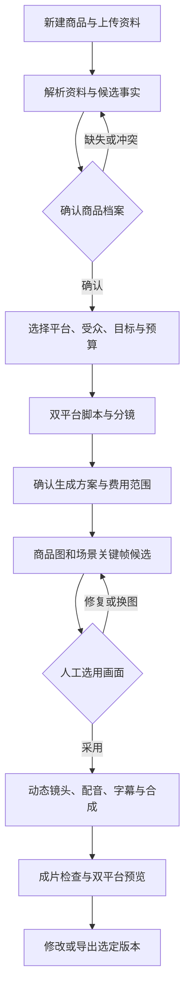

# AIGC 营销工作台 PRD v0.2

> 更新日期：2026-11-10｜阶段：需求定义／PoC 准备｜状态：评审草稿
>
> 作者：HX。产品负责人、技术负责人、设计负责人、测试负责人及评审人：HX。
>
> 本文定义首版产品语义、范围和验收计划。

## 0. 决策摘要与事实源

**产品定位：面向国内多平台电商商家和运营人员，以商品档案为核心，生成、修改和管理商品图片与营销视频的 SKU 素材工作台。**

首发聚焦 3C 配件和个护小家电，耳机、吹风机优先；首发平台抖音、小红书。首版跑通一个 SKU 的完整素材套件，后续扩展批量生产。核心价值为：上传一次资料，基于已确认商品事实生成两平台创意，复用已认可图片制作视频，并低成本修改。

### 0.1 来源与适用边界

| 来源 | 作用 | 证据边界 |
|---|---|---|
| [S1：市场调研与产品方向决策](../../AIGC营销工作台_市场调研与产品方向决策_2026-10-30.md) | 商品图＋视频方向、3C 首发、资源记录、市场与竞品假设 | 2026-10-30 调研文档；本次未重新核实市场、价格、政策与竞品现状 |
| [S2：商品视频产品分析与实施建议](../../AIGC营销商品视频工作台_产品分析与实施建议.md) | 商品事实、双平台脚本、分镜、修改、任务与验证原则 | 含 2026-10-23 GitHub 快照；未统一部署或实测 |

### 0.2 文档差异与本稿处理

| 差异／冲突 | 本稿处理 | 影响与决策状态 |
|---|---|---|
| S2 以视频为主、家居品类待定；S1 更新为图视频一体、3C 首发 | 按最新讨论采用图视频一体与 3C 范围，保留 S2 的完整生产流程 | 产品方向输入；后续样片验证 |
| S1 强调批量矩阵，S2 强调单商品先跑通 | 首版单 SKU 套件为 P0；跨 SKU 批量为 P1 | 本稿范围建议，评审确认后冻结 |
| S1 一处写“图 3 种”，另一处写“白底图 1＋场景图 2” | 样片和首版默认 3 张，即白底图 1＋场景图 2；详情页整套排版后续评估 | 本稿显式范围建议，不将三张解释为三种能力 |
| S1 将 ComfyUI 精修列为必做；S2 主张模型和实现经比较再选 | 商品保真、局部修复和拒用机制列为必做；ComfyUI 列为待选型，不指定为首版必选实现 | 2026-11-10 用户确认采用 PRD 口径，覆盖 S1 原必做要求；具体实现仍需评估 |
| S1 存在“无成熟竞品”“全部混剪”“成本显著更低”等强结论 | 仅保留为研究假设，不作为已证实优势或宣传承诺 | 需补充同商品对比证据 |
| S1 对标识、许可隔离有确定性表述，S2 要求核实 | 标识策略、许可和外部服务处理条款在目标版本核验后形成发布要求 | 不预设元数据等同隐式水印或进程隔离自动解决许可问题 |

### 0.3 核心假设

| ID | 类型与陈述 | 验证方法 | 停止／调整条件 |
|---|---|---|---|
| H-01 | 需求假设：多平台商家需要复用同一商品的图视频素材 | 访谈 5～10 位商家／运营，观察现有工作流程 | 无重复使用需求则收缩范围 |
| H-02 | 资源记录：S1 记载已有 3C 商家资源 | 产品负责人确认可参与商家、SKU 和素材授权 | 样本不可取得则调整验证排期 |
| H-03 | 效果假设：图视频复用减少修改与重复生成成本 | 与商家当前方法做配对任务测试 | 可用质量相同但总成本、操作负担无优势则调整 |
| H-04 | 技术假设：优选商品能保持足够的 Logo、形态与材质准确性 | 真实 SKU 样片盲评及细节对照 | 多次修复后仍不可用则限制 AI 改写商品主体 |
| H-05 | 商业假设：商家愿为稳定素材产能持续付费 | 原型／试用后访谈及后续真实付费实验 | 仅口头兴趣不能证明续费；未验证不扩大投入 |

## 1. 背景、用户与差异化

### 1.1 用户问题

商家需要反复核对商品资料，为不同平台写稿、出图、剪片；已认可的图片和脚本难以复用；模型生成可能改变商品细节；局部修改可能引发整片重做。问题频率、当前人工时间、外包成本与损失尚未取得一手基线。

### 1.2 用户与权限

首版采用账户私有工作空间，支持商家本人或单一运营人员完成创作。团队邀请、多人审片为 P1。平台管理员仅维护运行状态与版本配置，不默认读取商家原始资料；临时排障访问必须授权并留痕。

商家是商品事实与最终素材的确认人；系统负责来源与版本追踪、访问控制、预算和任务真实状态。消费者会受到图文描述影响，因此不得编造参数、认证、实测或使用经历。

| 场景 ID | 用户任务与输入 | 完成判据 | 优先级 |
|---|---|---|---|
| US-01 | 上传耳机／吹风机图片和说明资料，建立 SKU 档案 | 明确规格、来源、待确认项，用户确认一个档案版本 | P0，所有创作基础 |
| US-02 | 基于档案生成图片与抖音／小红书方案 | 三张可预览图片、两版可编辑脚本分镜，能识别表达差异 | P0，核心结果 |
| US-03 | 生成、审阅并导出素材套件 | 两条成片可播放，已选素材与发布文案对应正确 SKU／版本 | P0，闭环 |
| US-04 | 修改价格、文字、配音或单镜，恢复中断任务 | 看清影响和费用，仅执行必要阶段，旧版本保留 | P0，使用成本与可信度 |
| US-05 | 一批 SKU 生成多场景、多平台变体 | 批次有逐项预算、状态、暂停和结果汇总 | P1，单 SKU 验证后扩展 |

### 1.3 差异化与候选方案

竞争重点是商品事实一致、图视频资产复用、双平台创意与局部修改的组合体验。以上功能部分已存在于开源或商业产品中，尚无证据宣称独占能力。

| 路线 | 产品取舍 |
|---|---|
| 人工制作 | 作为对照，能控制事实和创意，实际成本待测 |
| 模板与确定性合成 | 用于真实商品展示、参数卡、字幕、编码和混音，降低主体变形风险 |
| 大模型生成 | 用于资料理解、候选卖点、脚本、场景图与动态候选，必须校验和审阅 |
| 传统视觉／OCR | 辅助文字识别、区域定位和差异提示；检测效果需标注评测 |
| 混合路线（推荐） | 真实商品素材＋受控场景生成＋确定性合成＋人工选用 |

参考 ClipForge 的商品工作流、MoneyPrinterTurbo 的合成链路、Pixelle-Video 的媒体能力组合及 AdCraft 的广告流程；采用代码前核对目标版本、许可和实际能力。首版不要求自训模型、RAG、微调或开放式多 Agent 编排。

## 2. 版本范围

### 2.1 P0：单 SKU 图视频完整闭环

- 中文桌面网页；账户隔离、登录、商品列表、项目与历史版本。
- 耳机、吹风机等优选静物商品；具体型号经样片验收后进入支持清单。
- JPG／PNG 商品图，PDF／DOCX／TXT 资料；可上传已有 MP4 视频参与混剪。
- 商品档案、事实与来源、候选卖点及人工确认。
- 默认一套为白底图 1 张、场景图 2 张、抖音视频 1 条、小红书视频 1 条；附封面、标题、文案与素材来源清单。
- 产品特写、图文混剪与有限 AI 场景候选；同片可组合。
- 两版脚本分镜、画面选择、中文配音、字幕、授权配乐、合成预览与导出。
- 局部修改、预算确认、任务恢复、取消、失败可见和检查提示。

### 2.2 P1／后续

跨 SKU 批量矩阵、同片多开头测试、品牌模板复用、团队协作、商家授权的效果录入。数字人口播为可选模块，人物使用图、服装试穿、其他平台和跨境另行验证。

首版通过下载包交付，不含自动发帖、自动投流、无人直播、自动竞品抓取、完整专业剪辑时间线与订阅支付。价格方案与充值支付在付费验证后单独定义。

## 3. 用户流程与页面

任何可能付费的阶段在执行前校验预算。流程中的确认可合并为明确的阶段操作，但不能因页面切换、刷新或自动续跑形成新的付费授权。

| 页面 | 核心内容与状态 |
|---|---|
| 商品列表／档案 | SKU、规格、授权素材、来源定位、事实状态；空态、解析中、待确认、已确认 |
| 创作设置 | 目标平台、受众、传播目标、形式、时长、素材使用方式、预算；不支持组合明确提示 |
| 双平台方案 | 并排脚本、创意摘要、事实依据、逐镜卡片；编辑保存、冲突、已过期、待确认 |
| 素材与分镜 | 原图对照、场景图、关键帧、单镜候选、修复范围与费用；未选用素材不能自动进入成片 |
| 预览与导出 | 图套件、两版成片、检查项、封面与发布文案、导出清单；部分成功、待复核、可导出 |
| 任务中心 | 阶段、真实进度、费用、取消、状态未知与恢复入口；刷新后恢复同一任务 |

按钮须区分“保存”“生成”“重新合成”和“付费重做”。无真实进度时展示阶段状态，不能伪造完成百分比。双平台内容不要求固定套话：抖音初始策略偏问题场景与集中展示，小红书偏需求、细节与选购说明；均为可编辑创意假设，不承诺流量。

## 4. 功能需求与可检验验收

P0 为首版试用必需；P1 为后续重要能力。下表的验收均为待执行要求。

| ID／场景 | 需求与优先级理由 | 条件—动作—结果及失败恢复 | 用例 |
|---|---|---|---|
| FR-01／US-01 | P0 上传解析，保证输入可用 | 给定支持文件，上传后展示逐文件状态及页码／图片来源；损坏、加密、超限或不支持文件逐项失败，保留其他文件，允许单项重传；同名文件不覆盖旧文件 | E-01 |
| FR-02／US-01 | P0 商品档案，约束生成事实 | 给定两份参数冲突资料，解析后并列显示来源并等待解决；缺少必需项时仍可保存草稿，但不能开始付费生产；确认后生成不可变档案版本 | E-02 |
| FR-03／US-01 | P0 规格隔离，避免串 SKU | 给定不同颜色／型号图片，用户明确分配当前 SKU；引用其他规格资产时阻止生产；无可用商品正面图时提示补充素材 | E-03 |
| FR-04／US-02 | P0 卖点与双平台创意 | 给定已确认档案，生成两版可编辑方案，每项参数有事实引用，标注受众、目标与表达差异；未证实认证、价格优惠、实测体验不得写入正式脚本 | E-04 |
| FR-05／US-02 | P0 分镜与计划，控制成本 | 给定方案，展示逐镜画面、口播、时长、事实引用、生成方式、预计费用；缺少素材或费用上界未知时阻止对应付费执行；用户可改用原图／已有素材 | E-05 |
| FR-06／US-02 | P0 三张商品图，提供独立产物 | 给定选定 SKU，白底图优先主体抠图合成，场景图保留原图对照；生成失败仅重做相应候选，三张分别选用、下载和记录版本；不得把场景图自动标为已通过保真检查 | E-06 |
| FR-07／US-02 | P0 保真检查及局部修复，满足 3C 使用 | 给定 Logo、按钮、轮廓或材质疑似失真，展示问题位置与原图，允许回贴、替换或修复候选；人工确认存在关键失真的候选不能进入发布导出，须替换或修复；自动漏检由人审补足 | E-07 |
| FR-08／US-03 | P0 图视频复用，减少重复生产 | 给定已选场景图，用于指定分镜时引用同一资产版本；只改字幕不能再次调用生图／生视频；图像改版不覆盖原视频，用户决定是否更新依赖 | E-08 |
| FR-09／US-03 | P0 视频制作，完成三种形式 | 给定已选画面和分镜，按计划组合特写、图文混剪及已验收的 AI 动态镜头；AI 动态失败时提供人工选择的静图方案并重新预览，不静默降级或继续收费重试 | E-09 |
| FR-10／US-03 | P0 配音字幕配乐，形成完整成片 | 给定确认脚本，中文配音可试听，字幕可改词与样式，音乐来源可追溯；用户改词后受影响配音／时间轴标为待更新，合成前检查超时、截断和遮挡 | E-10 |
| FR-11／US-03 | P0 双平台导出，交付可用套件 | 给定审核通过的当前版本，导出选定图片、两条 MP4、封面、标题文案及 manifest；清单含 SKU、版本、平台、授权／标识记录；部分失败可仅导出明确选中的已通过部分，状态保持“部分完成” | E-11 |
| FR-12／US-04 | P0 局部修改与回退 | 给定历史成片，修改单镜后展示影响与预算，只提交受影响生成；全局配音时长变化可触发时间轴重合成但不能无故重生画面；回退按新版本记录，无覆盖删除 | E-12 |
| FR-13／US-04 | P0 预算和幂等，避免重复费用 | 给定同次确认重复点击或重复回调，本地仅建立一个调用意图并按外部请求去重记账；外部服务支持幂等时验证仅一个外部任务，不支持时按第 6 节核查且禁止未知状态重发；超过授权上界前停止新调用；修改计划、涨价或付费重做超出授权须重新确认 | E-13 |
| FR-14／US-04 | P0 任务恢复与取消 | 给定生成中刷新／服务重启，重新进入恢复原任务；取消后不再提交后续步骤，已提交任务显示可能继续计费；外部状态未知先核查，不自动重新提交 | E-14 |
| FR-15／US-03 | P0 导出检查与标识辅助 | 给定平台版本，依据已核验规则执行规格、标识和发布检查，记录规则版本；AI 检测提示须人工确认，确定性规则不通过阻止发布包导出；规则未核验的环境只供内部样片验证 | E-15 |
| FR-16／全部 | P0 账户隔离、删除与访问 | 给定另一账户的商品／任务／媒体 ID，访问与下载被拒绝；删除商品先展示受影响资产，撤销其访问并按保留策略处理引用与物理文件；日志不暴露原文和密钥 | E-16 |
| FR-17／US-05 | P1 批量生产，提高产能 | 给定多个已确认 SKU，为每项预检预算和规格；失败不污染其他商品；可暂停尚未提交项、逐项续跑并汇总结果；需先通过单 SKU 试用门禁 | 后续补充 |

### 4.1 输入与输出限制

PoC 建议配置：每项目最多 20 张图片、10 份文件及 5 段自有视频；单图 20 MB、单文档 30 MB／PDF 100 页、单视频 200 MB／120 秒；单项目总计 1 GB。以上为资源控制的拟定上限，未经实测，不代表容量承诺。服务端与页面需使用同一限制配置；开发前经解析和存储测试定稿。

必需商品字段：商品名、商家 SKU 标识、明确型号／规格或“单规格”确认、当前商品图；拟用于文案的每一项参数和卖点须有已确认来源。价格和认证不是必填，不提供就不生成相关宣称。

PoC 建议视频时长档位 15／30 秒，画面默认竖屏 9:16、1080×1920，MP4 H.264＋AAC；图片默认 PNG／JPG，白底及场景图初始 1:1、封面初始 3:4。它们是测试预设，不是两平台强制规范；平台规格核验后冻结各类发布配置，合成后实际探测编码、尺寸、时长和音轨。

### 4.2 版本依赖与导出契约（FR-08、11、12、15）

- 完整套件包含白底图 1 张、场景图 2 张、两平台各 1 条视频、各 1 张封面及各 1 组标题／发布文案、1 份 manifest。三图可共用，两平台成片和配套文案须分别绑定平台与版本。封面可取自已采用画面，无需额外生图。M-02 仅在全部必需项通过时计成功；25～50 件样本指核心图视频，不含配套项，配套项仍须审核。
- 档案更新不覆盖历史资产。计划、脚本、画面、配音、字幕和导出包保存依赖版本。修改事实或脚本后，受影响项标为待更新／待复核，旧审核不能沿用；新确认前阻止对应发布导出。纯字幕样式改动仅重合成并复核，不重生画面或配音；口播改词须更新配音与字幕；仅字幕纠错须检查与口播及商品事实一致。
- 历史档案被新版本替代时提示差异并重新确认适用性；若因事实错误被撤销，则阻止受影响历史版本再次发布导出。历史下载包无法远程撤回，须提示用户停止使用。回退生成新版本，不能恢复已撤销事实的有效性。
- 区分内部样片下载与发布包导出：规则未核验或审核未通过的候选只可作为带“内部样片／未审核”提示的预览下载，不计完成或采用；发布包要求事实、保真、授权、规格与标识检查全部通过。FR-06 单图下载及 FR-11 部分导出同样适用此规则。
- 发布 manifest 至少包含套件及 SKU ID、档案／计划版本、每文件的资产版本、平台、用途、校验摘要、审核记录、规则版本和授权来源记录。来源清单不附带原始业务文件、密钥或临时访问链接。

### 4.3 输入与授权补充（FR-01、13、16）

扫描 PDF 纳入逐页 OCR；无法定位或识别的内容标为待确认，不作为已确认事实。DOCX／TXT 使用段落定位。用户手填事实记录确认人和时间，不能伪造文件来源。文件类型以实际内容校验；解压与解析资源上限在 G-02 前配置，超限逐文件失败。

上传素材使用权确认不等于同意外发。首次第三方处理前展示服务商、发送资料范围、用途及费用上界，由用户明确授权；拒绝时保留本地草稿并提示该能力不可执行。授权涵盖 OCR、文本、图像、视频、配音及收费检查，不仅限于成片生成。未授权不得把原始业务资料发送给外部模型。

## 5. 数据、AI 输出与系统职责

### 5.1 关键对象

| 对象 | 必需语义 |
|---|---|
| 商品／SKU | 工作空间、商家标识、规格；与另一规格独立 |
| 档案版本 | 事实值、单位、来源文件及定位、人工确认记录；确认版本不可原位修改 |
| 创作计划 | 档案版本、平台、受众、目标、脚本分镜、预算和确认状态 |
| 分镜 | 顺序、时长、口播、画面方式、事实引用、资产版本、音轨方式 |
| 资产版本 | 原始／生成类型、来源、SKU、生成配置、父资产、采用与检查状态 |
| 任务／外部调用 | 计划版本、幂等键、外部 ID、阶段状态、预算预留、费用和错误 |
| 导出包 | 精确选定版本、文件清单、检查与标识记录、完成状态 |

数据库生成正式 ID、状态和账目；模型不得自拟正式 ID、伪造来源或直接确认商品。事实引用必须真实存在于当前授权档案版本。脚本和分镜输出经结构、引用、单位数值和时长校验后才作为候选保存。

### 5.2 AI 执行链路

| 节点 | 执行方式 | 失败处理 |
|---|---|---|
| 文件读取与 OCR | 工具＋模型辅助提取，保留来源 | 逐文件失败，允许手动填写并明确记为用户来源 |
| 卖点、脚本与分镜 | 文本／视觉模型生成候选，人工确认 | 格式不合格可在既定预算内修复一次，仍失败则展示可编辑草稿 |
| 场景和动态候选 | 经测评的图像／视频服务 | 候选保留，用户决定替换或重做 |
| 文字与视觉检查 | 数值引用规则、OCR／视觉辅助、人工对照 | 自动结果只表示提示或检查结果，不替代所有人工责任 |
| 预算、权限、状态、重试 | 确定性代码 | 不满足条件阻止对应操作 |
| 编码、字幕与混音 | 确定性媒体工具 | 保存有效素材，允许只重跑合成 |

上传文件中的指令均视为商品内容，不可改变系统权限、调用目标、费用和生成规则。首版不自动访问资料中的外链；原始上传文件不执行宏或脚本。

### 5.3 模型与 Prompt 选型

每类能力先选一个主力候选，不预建动态多模型路由。文本、图像、视频、中文配音的具体服务、版本、地域、价格、数据处理条款和许可均待真实测试。开源 GPU 自托管与 API 应比较包含 GPU 空闲、维护、失败和重做的总成本。

Prompt 必须使用已确认档案和当前分镜约束，声明禁止编造参数、认证、促销、个人体验及商品外观；输出简要创意依据和事实引用，不索取内部思维过程。没有可靠来源就省略相关卖点。

实际模型、Prompt、Schema、参数、规则及素材版本均需随任务记录。详细 Prompt 与接口 Schema 在开发前形成专项契约；当前尚未创建，不把本文语义表当作可执行 Schema。模型或 Prompt 更换需回归 E-02、E-04、E-07、E-09 等关联用例。

### 5.4 资料与权利管理

上传时确认素材使用权；音乐和字体采用可核对商业使用范围的资源，来源不明的资源不得用于发布导出。原图、文件和生成媒体默认工作空间私有，仅为已授权的处理任务提供临时受限访问，第三方访问与保留条款在接入前确认。

默认不将商家资料用于训练或共享模板。删除应处理原始文件、候选、缓存、临时链接和备份保留例外；物理清除时限、备份期限和业务日志期限待部署方案确定，并在目标用户试用前明确告知。删除中的项目禁止启动新生成，已提交外部任务按可取消能力处理。

## 6. 状态、异常与费用控制

创作计划状态：草稿 → 待确认 → 已确认；修改生成新版本，旧确认不自动授权新版本。

执行任务状态：排队 → 执行中 → 成功／失败；执行中可转外部状态未知，核查后再进入对应状态；排队或执行中可转取消中 → 已取消。成功仅表示结果已持久化且技术校验通过，不表示人审采用。终态不可因迟到回调复活；重做建立关联原任务的新任务并重新校验授权。

套件状态根据固定清单独立汇总：制作中、待复核、部分完成、完成。待复核表示有待审候选；部分完成表示部分交付项通过、其他项未通过；全部必需项通过且 manifest 校验一致才为完成。已取消任务的迟到结果仅用于费用核查和记录，不自动进入套件。费用状态独立维护，任务取消不代表费用已结清。

| 异常 | 必需行为 |
|---|---|
| 鉴权、参数、审核拒绝或不支持能力 | 不盲重试；说明可执行的修改或配置动作 |
| 429、暂时网络失败 | 已确认未提交的请求可退避重试最多 2 次，总费用与时间仍受授权限制；提交状态不明先查询 |
| 外部任务超时／响应丢失 | 标为状态未知，保留外部 ID 或请求证据，查询与对账；无确定结果前不重新创建 |
| 平台不支持幂等且提交证据缺失 | 保留待核查状态，人工核查后才允许新提交；不能声称零重复收费保证 |
| 用户取消 | 停止新步骤；外部取消结果分别显示，已发生费用不伪称退回 |
| 合成失败／存储失败 | 素材保留，恢复同一计划；未持久化与校验完成不得标成功 |
| 部分套件成功 | 明确缺失项；允许导出选中且已通过检查的部分，不计为完整成功套件 |

提交前按本次计划与价格版本预留预算；费用账目区分预计、预留、已确认和未知。无法确认单次最高成本时阻止付费提交；价格变化超出原授权范围重新确认。PoC 的项目金额上限、视频轮询截止时间和总执行时限需在模型选型后签定，未配置有效值的环境禁止真实付费任务。

### 6.1 预算一致性与恢复验收（E-13、E-14）

费用授权绑定账户、计划版本、服务／价格版本、币种、有效期与最高金额；PoC 不含充值支付，展示的是运行成本及预算授权，不能称为用户已扣款。上界计入可收费的失败、修复、重试和取消后已提交调用；预算不足则等待新授权，不能静默降低计划质量。

并发提交须原子校验“已确认费用＋未知费用预留＋新调用最大费用 ≤ 授权上限”；未知费用不释放预留。回调、轮询与账单核查合并同一调用记录，不重复累计。取消后仅在取得明确结算／未收费证据后释放预留；无法核实则保持未知并由 HX 处理。查询轮询也受截止时间和费用上界约束。

增加验收：预算仅够一次时两个并发提交最多放行一个；解析前未授权则无外发调用；取消与成功回调竞态不复活流程；未知费用保留预算且在界面可见；回调与查询同时到达只更新一次费用。

## 7. 目标、指标与性能

目标 BG-01：商品信息准确；BG-02：完成双平台套件；BG-03：减少人工修改与可用素材成本；BG-04：可靠、可追溯地执行。当前基线均未测量。

| 指标 | 关联目标／需求 | 定义与分母 | 基线／目标及验证方法 |
|---|---|---|---|
| M-01 严重商品错误 | BG-01／FR-02、03、07 | 已审最终素材中存在错型号、关键结构、参数或虚构认证的件数／已审件数；逐 SKU 分组 | 基线待测；发布验收样本要求已知严重错误为 0，不能以均分抵消 |
| M-02 完整套件成功率 | BG-02／FR-06～11 | 在授权预算和约定期限内完成且人审采用的 3 图＋2 视频套件／已确认提交套件 | 失败、取消、未知状态均保留在分母并分列原因；目标试用前依据 PoC 制定 |
| M-03 采用率及保真 | BG-01／FR-07 | 采用资产／已审候选；Logo 合格数／有 Logo 已审候选；材质首轮合格数／首轮已审候选 | 不能只评修复后的结果；耳机／吹风机、材质分组；目标待测 |
| M-04 人工时间 | BG-03／FR-12 | 单套件实际操作时间及单镜／改字幕操作时间，统计中位数和范围 | 与商家现有方法配对；等待时间另列，改善目标评审后确定 |
| M-05 成功套件总成本 | BG-03／FR-13 | 同批次所有生成、失败、重做、渲染、存储成本／完整采用套件数 | 零成功报告不可计算并披露总损失；自托管含分摊算力；价格目标待测 |
| M-06 延迟与资源 | BG-04／FR-14 | 阶段与全流程 p50／p95、队列等待、渲染峰值内存和 CPU／GPU、外部调用数 | PoC 提议全局真实生成并发 1；容量与期限正式试用前按实测配置 |
| M-07 可靠性硬约束 | BG-04／FR-13、14、16 | 已知重复提交、越权访问、已确认费用超授权、假成功次数 | 验收用例要求 0；外部未知费用必须单列，不可按 0 统计 |

数据来源为任务记录、费用账、成片探测、人审表与操作事件。指标负责人按文首角色均为 HX；商家事实审核人须在样本登记时另行指定。每次 PoC、试用结束出一份含分母、失败和分组的报告。

UI 响应的拟定目标：普通保存／状态读取在约定测试环境和并发下 p95 ≤2 秒；不含文件传输或外部生成。它是待验证工程目标，依据为避免日常编辑被长任务阻塞。正式测试前记录环境、数据量和并发；模型任务不能以该目标冒充端到端承诺。

## 8. 评测与验收用例

用例 E-01～E-16 对应 FR-01～FR-16；均覆盖成功、边界、失败与恢复，当前执行数为 0。重点输入与判分：

| 用例 | 样本／操作 | 判定方式 |
|---|---|---|
| E-01～03 | 损坏、超限、扫描文档、不同版本参数冲突、两颜色图片混用 | 检查文件状态、来源定位、确认阻断和 SKU 引用；确定性断言＋人工抽查 |
| E-04～05 | 缺价格／认证，资料夹带“忽略规则”，双平台草稿和费用未知 | 不编造、无越权执行、事实引用有效；两版表达差异由运营解释与评分 |
| E-06～07 | 小 Logo、按键、高光、哑光等首轮和修复候选 | 原图并排对照，逐项标注形态／Logo／材质；记录漏检、误报与人工仲裁 |
| E-08～10 | 改字幕、替换关键帧、动态失败、长配音、音乐或字体缺授权 | 查实际外部调用、资产版本、时间轴、音轨及缺授权阻断 |
| E-11～12 | 部分视频失败、旧档案、单镜重做、历史回退 | 校验导出内容与清单一致、部分状态真实、旧版可用、实际执行范围正确 |
| E-13～14 | 双击、重复回调、提交后断网、服务重启、取消与迟到结果 | 核对外部 ID、费用预留及终态；迟到结果不得复活已取消工作流 |
| E-15～16 | 未核验规则、标识缺失、越权媒体链接、删除中任务 | 阻断发布导出、禁止跨账户读取、撤销访问并记录删除处理 |

PoC 样本建议为真实授权的 5～10 个 SKU，覆盖耳机／吹风机及优选材质；每 SKU 默认 3 图＋2 视频，共 25～50 件最终资产，另记录全部候选。该规模用于发现问题和比较流程，不足以证明市场规模或稳定高成功率。

将样本按 SKU 分为调优和独立留出，具体划分、数值目标、预算和截止时间在执行前登记；不能用同一商品的另一配色冒充独立留出。随机性测试次数依据探索样本波动制定，独立留出测试前登记。不得根据留出结果调整门槛；调整后须使用新的独立留出样本复验。与商家当前工具／人工流程配对比较，预算、输入、操作熟练度和目标一致，无法等同时披露差异。

至少由商品熟悉者检查事实和细节、运营检查表达与可用性，尽可能隐去工具来源。评分分为事实／外观硬错误，以及画面、文案、节奏、平台适配四项 1～5 分主观分；双方先对样例校准，分歧保留并由指定商品责任人仲裁。LLM 评分只能辅助，自动失真检查应使用人工标签评估漏检与误报。

失败记录必须含复现输入、版本、阶段、影响、费用、判分、负责人和回归用例。点赞、下载和重生成仅是行为信号，不能直接代替采用或正确性标签。

## 9. 分阶段发布、监控与回退

| 门禁 | 进入与必需证据 | 通过／停止条件 | 决策与回退 |
|---|---|---|---|
| G-01 范围冻结 | SKU 样本、用户资源、限额、标识与许可待决项有明确处理 | 产品确认本稿范围；无法取得授权样本则停止真实验证 | 产品负责人；文档可修订 |
| G-02 工程验证 | FR-01～16、E-01～16 的结构／Mock／恢复报告 | 确定性硬约束通过；记录未验证外部行为 | 技术＋测试；关闭真实调用开关 |
| G-03 真实 PoC | 选定 Provider、授权预算、版本和独立样本报告 | 已知严重错误为 0；探索样本用于制定成本、耗时与采用目标；独立留出测试前冻结目标，留出结果达到目标；达不到则返工或收缩形态 | 产品＋技术＋商家；停用问题生成方式，保留原图合成 |
| G-04 邀请试用 | 权限删除、费用、标识规则、配置及监控确认，所有 P0 验收可追溯 | 无未处理关键错误；目标用户能完成完整任务；未知费用和外部状态均可核查 | 产品负责人；限制新任务，保留已导出成果 |
| G-05 批量扩展 | 单 SKU 重复使用与付费意愿证据、并发容量报告 | 逐项预算、失败隔离和恢复验证后，另补批量需求 | 再评审；降回单任务并发 |

监控 MON-01：失败、外部状态未知、重复回调、预算异常、排队时间、渲染资源、导出失败和跨账户拒绝事件。任何已确认越权或超授权提交立即停用相关入口并通知负责人；任务时长异常阈值按所选模型实测设定，未配置监控与告警接收人不得进入试用。

回退分别覆盖应用版本、Prompt／模型／规则配置和创作计划；已有成片保留版本标识。关闭 Provider 后不再创建新请求，已有任务继续查询或核查。不能通过换模型静默规避审核或预算。供应商价格、模型、数据政策与平台规则变化触发相关复评。

## 10. 里程碑、依赖与待决事项

| 里程碑 | 交付物 | 依赖／负责人 | 时间与现状 |
|---|---|---|---|
| MS-01 需求与样本确认 | 冻结范围、商家名单、授权 SKU、成本基线 | 产品负责人 HX | 待排期；本稿为草稿 |
| MS-02 原型与技术试验 | 页面与失败恢复原型，商品图／视频保真和调用实验 | 设计／技术负责人 HX | 原型、技术实验均未创建 |
| MS-03 单 SKU 实现 | P0 功能、输出契约、任务和费用状态、E-01～16 报告 | 工程／测试负责人 HX | 未开发 |
| MS-04 真实套件验证 | 留出样本、盲评、成本／性能及失败报告 | 测试负责人 HX＋商家审核人待指定 | 未执行 |
| MS-05 邀请试用 | 用户任务完成、重复使用、可接受价格与问题记录 | 产品负责人 HX | 未执行，不承诺上线日期 |

| 待决事项 | 影响／所需证据 | 最迟确认点 |
|---|---|---|
| 保真与局部修复实现选型 | ComfyUI 为候选之一；与 API／原图合成对比质量、维护、许可与总成本，按验证结果选定 | MS-02 后、开发方案冻结前 |
| 各类模型／服务与数据条款 | 质量、时长、地域、价格、取消和查询能力 | G-03 前 |
| 输入上限、目标视频规格、每任务预算与超时 | 本文拟定值需测试与服务商依据 | G-03 前；付费配置缺失则阻止调用 |
| 抖音／小红书标识与规格规则 | 官方来源、适用范围、规则版本、实际导出校验；不以竞品说明替代 | 目标平台发布包启用前 |
| 试用指标目标、并发与容量 | 真实 PoC、成本、操作时间和资源数据 | G-04 前 |
| 保留／物理删除／备份期限 | 部署、存储、Provider 能力及用户告知 | G-04 前 |
| 商业定价与持续付费 | 样片后访谈、单位成本及后续真实付费实验 | 收费版本立项前 |

当前已形成 [技术设计 v0.1](技术设计文档_v0.2.md)，为待实施的技术评审草稿，无代码实现和运行证据。可执行 Schema／Prompt、页面原型、平台规则记录及评测报告仍为计划产物，需分别完成后链接回本稿。

### 修订记录

| 版本 | 日期 | 变更 |
|---|---|---|
| v0.1 | 2026-11-03 | 综合 S1、S2 与对话形成首版 PRD；明确图视频一体、3C 首发、单 SKU 套件与批量边界，列明冲突、假设、验收及发布前置条件 |
| v0.2 | 2026-11-10 | 记录用户确认 ComfyUI 待选型并解除来源冲突；修复责任人、幂等承诺与评测门槛；补充套件清单、版本失效、样片／发布导出、外发授权、预算并发及独立状态语义；保留原文件路径以避免断链 |

### 本轮审查与剩余阻断

本轮为文档审查，未执行代码测试、真实模型评测、平台规则核验或上线验收。原稿保存于 [修订前归档](../v0.1/产品需求文档_PRD_v0.1.md)。

| 问题 | 修复位置／验证要求 |
|---|---|
| 责任人前后不一致、来源表空行 | 文首、第 7／10 节统一；商家审核人仍待确定 |
| 套件配套项、旧版本及单图导出条件不完整 | 4.2；E-08、11、12、15 增加旧事实撤销、样片与发布包隔离、配套项缺失用例 |
| 前置调用授权与预算竞态遗漏 | 4.3、6.1；E-01、13、14 验证无授权不外发及并发预留 |
| 外部幂等绝对承诺与不支持幂等的异常规则冲突 | FR-13 改为本地保证与外部能力边界分别验收 |
| 执行成功、人审与套件完成混用 | 第 6 节分开定义；E-14 验证终态与迟到回调 |
| 先看评测结果再定目标可能造成验收失真 | 第 8 节、G-03 规定探索制定门槛、留出前冻结 |

**已确认决策（2026-11-10）：** 用户明确采用 PRD 口径：ComfyUI 列为待选型，不作为首版必选实现，覆盖 S1 原要求。商品保真、局部修复和拒用机制仍为 P0。解除该文档冲突对范围冻结的阻断；具体技术方案仍须比较和验证，本决策不代表任何替代实现已通过验收。

**进入真实验证前的缺口：** 服务商与数据处理授权、有效预算／超时配置、样本及评测目标；进入试用前还须完成平台规则核验、删除期限与全部 P0 证据。本文中的拟定上限与目标均不是实测结果。
